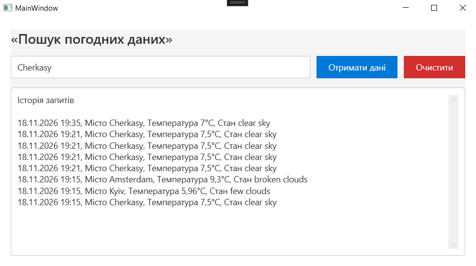
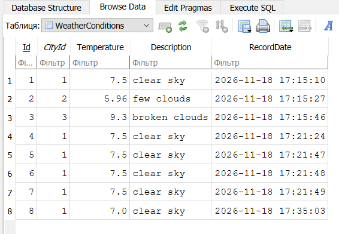
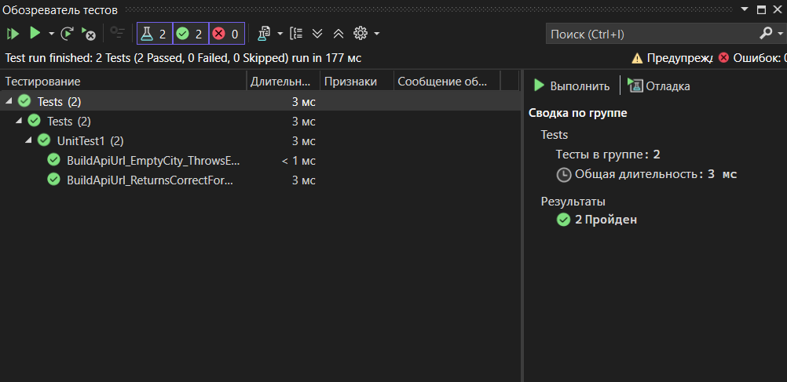

# Weather WPF Client

Цей проєкт є клієнтським застосунком для пошуку та збереження погодних даних.

## Опис API
У проєкті використовується OpenWeatherMap API. Запит виконується до кінцевої точки поточних погодних даних із передачею назви міста як параметра та ключа авторизації. Відповідь сервера у форматі JSON десеріалізується для отримання температури та опису стану погоди.

## Кроки для запуску
1. Склонувати репозиторій на локальний комп'ютер.
2. Відкрити рішення FullStackLab.sln у середовищі Visual Studio.
3. Додати власний ключ API за допомогою інструменту User Secrets. Для цього треба натиснути правою кнопкою миші на проєкт WpfClient, обрати керування секретами користувача та додати рядок "OpenWeatherApiKey" зі своїм ключем.
4. Запустити проєкт. База даних SQLite із двома таблицями та зв'язками створиться автоматично при першому запуску програми.

## Демонстрація роботи

 

# Weather WPF Client (English)

This project is a client application for searching and saving weather data.

## API Description
The project uses the OpenWeatherMap API. The request is made to the current weather data endpoint, passing the city name as a parameter and the authorization key. The server's JSON response is deserialized to extract the temperature and weather condition description.

## How to Run
1. Clone the repository to your local machine.
2. Open the FullStackLab.sln solution in Visual Studio.
3. Add your own API key using the User Secrets tool. Right-click the WpfClient project, select Manage User Secrets, and add the "OpenWeatherApiKey" string with your key.
4. Run the project. The SQLite database with two tables and relationships will be created automatically upon the first launch.

## Showcase

